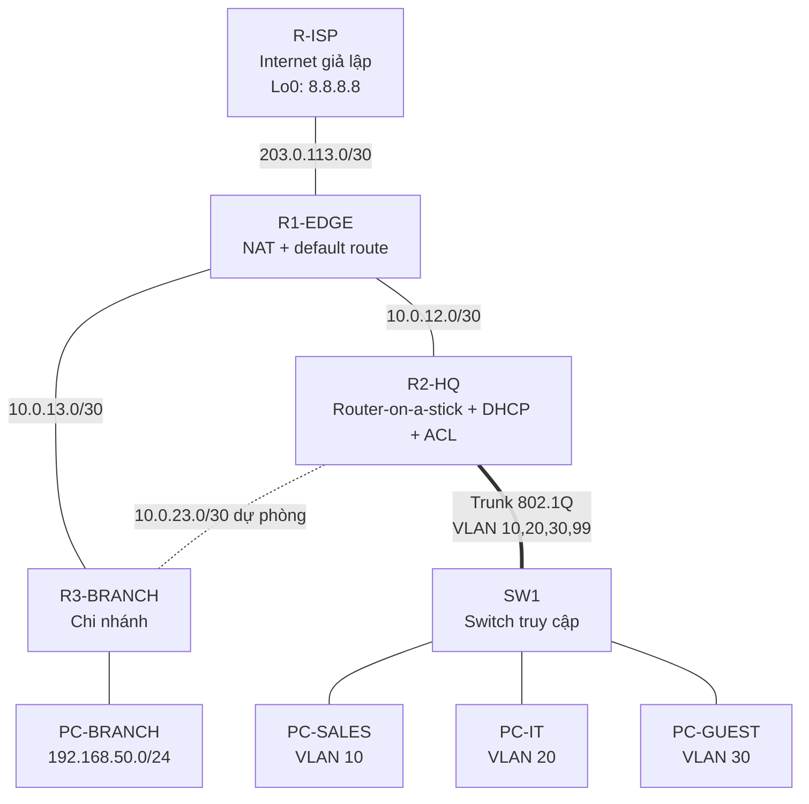

# 🏢 Mô phỏng mạng doanh nghiệp (GNS3)

Thiết kế và cấu hình mạng cho một công ty nhỏ gồm **trụ sở chính có nhiều phòng ban** và **một chi nhánh**. Mạng có phân vùng bằng **VLAN**, **định tuyến inter-VLAN**, **cấp phát DHCP**, **định tuyến động OSPF** có đường dự phòng, **NAT** ra Internet và **ACL** kiểm soát truy cập giữa các phân vùng.

*A GNS3 lab of a small enterprise network: VLAN segmentation, router-on-a-stick inter-VLAN routing, DHCP, OSPF with a redundant path, PAT to the Internet, and ACL-based segmentation (guest isolation, management access).*

> 📌 **Trạng thái:** thiết kế, bảng địa chỉ và cấu hình đầy đủ cho 5 thiết bị đã sẵn sàng. Ảnh chụp topology và kết quả kiểm tra sẽ bổ sung sau khi chạy lab.

## Sơ đồ mạng


## Bảng địa chỉ IP
| Thiết bị | Cổng | Địa chỉ | Ghi chú |
|---|---|---|---|
| R-ISP | Gi0/0 | 203.0.113.1/30 | Phía nhà mạng |
| R-ISP | Lo0 | 8.8.8.8/32 | Giả lập máy chủ Internet |
| R1-EDGE | Gi0/0 | 203.0.113.2/30 | `ip nat outside` |
| R1-EDGE | Gi0/1 | 10.0.12.1/30 | Tới R2, `ip nat inside` |
| R1-EDGE | Gi0/2 | 10.0.13.1/30 | Tới R3, `ip nat inside` |
| R2-HQ | Gi0/0 | 10.0.12.2/30 | Tới R1 |
| R2-HQ | Gi0/2 | 10.0.23.1/30 | Đường dự phòng tới R3 |
| R2-HQ | Gi0/1.10 | 192.168.10.1/24 | Gateway VLAN 10 – Sales |
| R2-HQ | Gi0/1.20 | 192.168.20.1/24 | Gateway VLAN 20 – IT |
| R2-HQ | Gi0/1.30 | 192.168.30.1/24 | Gateway VLAN 30 – Guest |
| R2-HQ | Gi0/1.99 | 192.168.99.1/24 | Gateway VLAN 99 – Management |
| R3-BRANCH | Gi0/0 | 10.0.13.2/30 | Tới R1 |
| R3-BRANCH | Gi0/2 | 10.0.23.2/30 | Đường dự phòng tới R2 |
| R3-BRANCH | Gi0/1 | 192.168.50.1/24 | LAN chi nhánh |
| SW1 | VLAN 99 | 192.168.99.2/24 | Địa chỉ quản trị |
| Các PC | – | DHCP | Cấp bởi R2 hoặc R3 |

## Bảng VLAN
| VLAN | Tên | Mạng | Cổng trên SW1 | Chính sách |
|---|---|---|---|---|
| 10 | SALES | 192.168.10.0/24 | Gi0/1 | Vào được mạng nội bộ và Internet |
| 20 | IT | 192.168.20.0/24 | Gi0/2 | Là VLAN **duy nhất** vào được VLAN 99 |
| 30 | GUEST | 192.168.30.0/24 | Gi0/3 | **Chỉ ra Internet**, bị chặn vào mọi mạng nội bộ |
| 99 | MANAGEMENT | 192.168.99.0/24 | SVI | Quản trị thiết bị mạng |

## Các tính năng đã cấu hình
| Tính năng | Thiết bị | Mục đích |
|---|---|---|
| VLAN và trunk 802.1Q | SW1, R2 | Tách các phòng ban thành các miền broadcast riêng |
| Router-on-a-stick | R2 | Định tuyến giữa các VLAN qua 1 cổng vật lý |
| DHCP server | R2, R3 | Tự cấp IP, gateway, DNS; chừa sẵn 10 địa chỉ đầu mỗi mạng |
| OSPF area 0 | R1, R2, R3 | Định tuyến động, tự chuyển sang đường dự phòng R2–R3 khi đứt link |
| `passive-interface` | R2, R3 | Không gửi gói OSPF hello xuống mạng người dùng |
| `default-information originate` | R1 | Phát default route vào OSPF để cả mạng biết đường ra Internet |
| NAT overload (PAT) | R1 | Mọi mạng 192.168.x.x ra Internet bằng một IP public |
| ACL `GUEST-IN` | R2 | Cô lập mạng khách |
| ACL `MGMT-OUT` | R2 | Chỉ phòng IT quản trị được thiết bị |

## Cách chạy lab
1. Cài **GNS3** và **GNS3 VM**.
2. Image thiết bị: **Cisco IOSv** (router) và **IOSvL2** (switch), có trong gói Cisco Modeling Labs. Máy PC dùng **VPCS** có sẵn trong GNS3.
3. Kéo thiết bị vào, nối dây đúng theo sơ đồ và bảng địa chỉ.
4. Mở console từng thiết bị, vào `configure terminal` và dán file tương ứng trong thư mục [`configs/`](configs).
5. Trên mỗi VPCS, gõ `ip dhcp` để xin IP.
6. Làm theo các bài kiểm tra trong [docs/verification.md](docs/verification.md).

Không có image Cisco? Toàn bộ cấu hình dùng cú pháp Cisco IOS chuẩn nên chạy được trên **Cisco Packet Tracer** (router 2911, switch 2960). Lưu ý: switch 2960 không có lệnh `switchport trunk encapsulation dot1q`, chỉ cần bỏ dòng đó.

## Cấu trúc repo
```
configs/
  R-ISP.cfg       R1-EDGE.cfg     R2-HQ.cfg
  R3-BRANCH.cfg   SW1.cfg
docs/
  verification.md   kịch bản kiểm tra và kết quả mong đợi
```

## Kiến thức áp dụng
VLAN, trunk 802.1Q, inter-VLAN routing, DHCP (DORA, excluded-address, lease), OSPF (router-id, neighbor, DR/BDR, passive interface, default route), NAT/PAT, ACL standard và extended (wildcard mask, chiều in/out), quy hoạch địa chỉ IP với subnet /24 và /30.

## Hướng phát triển
- [ ] Thay router-on-a-stick bằng switch lớp 3 (SVI)
- [ ] HSRP để dự phòng gateway
- [ ] Port security và DHCP snooping trên SW1
- [ ] Đường hầm IPsec site-to-site giữa trụ sở và chi nhánh
- [ ] Tự động sao lưu cấu hình bằng Python (Netmiko)

## Tác giả
**Nguyễn Quốc Việt** · [GitHub](https://github.com/nqv0503) · Giấy phép [MIT](LICENSE)
